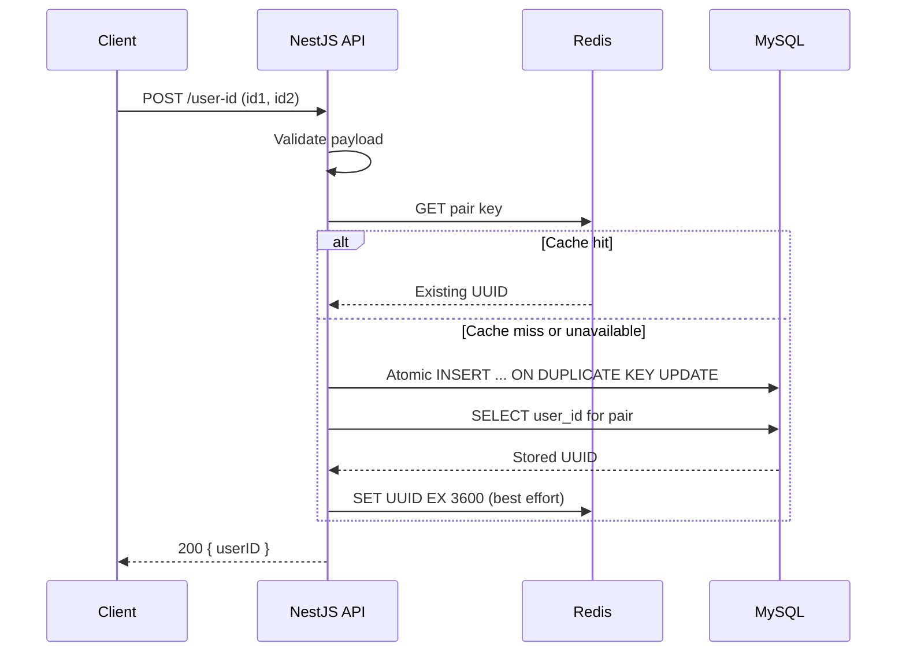

# User ID Mapping API

A NestJS REST API that returns a stable UUID v4 for an ordered pair of identifiers (`id1`, `id2`). The first request for a pair creates and persists a mapping in MySQL 8; subsequent requests return its original `userID`. Redis provides an optional read-through cache, while MySQL remains the source of truth.

## Technology

- Node.js 22, TypeScript, NestJS 11
- MySQL 8 (`mysql2` connection pool)
- Redis 7 (`ioredis`), optional
- Jest, Supertest, Docker Compose

## Prerequisites

- Docker Desktop / Docker Engine with Docker Compose v2
- Node.js 22 and npm to run tests on the host
- Free local ports `3000`, `3306`, and `6379` (or adjust the port mappings in `compose.yaml`)

## Installation and startup

1. Create the local environment file:

   ```bash
   cp .env.example .env
   ```

   Set `MYSQL_ROOT_PASSWORD` and `MYSQL_PASSWORD` to local development passwords in `.env`. Do not commit this file.

2. Start the API, database, and Redis:

   ```bash
   docker compose up --build -d
   docker compose ps
   ```

3. The API is accessible at `http://localhost:3000` once MySQL is healthy.

The table definition in [`database/schema.sql`](database/schema.sql) runs automatically when the MySQL data volume is first initialized. Existing volumes are preserved on subsequent starts.

To stop the containers without deleting database records:

```bash
docker compose down
```

### Local development without the API container

```bash
docker compose up -d mysql redis
npm ci
npm run start:dev
```

The example environment file uses localhost addresses for this mode. Compose overrides the database and cache hostnames when the API runs in a container.

## Configuration

| Variable | Purpose | Default / example |
| --- | --- | --- |
| `MYSQL_ROOT_PASSWORD` | MySQL root password used by Docker Compose | Set in `.env` |
| `MYSQL_USER` | Application database user | `appuser` |
| `MYSQL_PASSWORD` | Application database password | Set in `.env` |
| `MYSQL_DATABASE` | Database selected by the NestJS connection | `id_service` |
| `MYSQL_HOST`, `MYSQL_PORT` | MySQL address for local development | `127.0.0.1`, `3306` |
| `REDIS_ENABLED` | Disable cache when `false` | `true` |
| `REDIS_HOST`, `REDIS_PORT` | Redis address for local development | `127.0.0.1`, `6379` |
| `PORT` | HTTP port for local development | `3000` |

The Docker Compose configuration and SQL initialization script use the database name `id_service`. If changing the database name, update both of those files as well.

## API contract

`POST /user-id` with `Content-Type: application/json`

Request:

```json
{
  "id1": "ABC123",
  "id2": "XYZ456"
}
```

Response (`200 OK` for both newly created and existing mappings):

```json
{
  "userID": "550e8400-e29b-41d4-a716-446655440000"
}
```

The UUID shown is an example. The actual result is generated using UUID v4.

Try the endpoint:

```bash
curl -i -X POST http://localhost:3000/user-id \
  -H 'Content-Type: application/json' \
  -d '{"id1":"ABC123","id2":"XYZ456"}'
```

Sending the same pair repeatedly returns the same `userID`. Changing either identifier creates a new pair.

### Validation and errors

- Both identifiers are required, nonempty strings, at most 128 characters, with no whitespace.
- Unknown request-body fields are rejected.
- Invalid input returns `400 Bad Request`.
- A database operation failure returns `503 Service Unavailable` with a generic message rather than internal database details.

Authentication was not part of the specified API requirements and is not implemented.

## Database design

The `user_mappings` table defines:

| Column | Type / constraint |
| --- | --- |
| `id` | `BIGINT UNSIGNED`, auto-increment primary key |
| `id1`, `id2` | `VARCHAR(128)`, `NOT NULL`, binary collation |
| `user_id` | `CHAR(36)`, UUID v4 string |
| `created_at` | Creation timestamp |

The unique constraint on `(id1, id2)` ensures at most one record for each ordered pair. Identifier comparisons are case-sensitive, so `(ABC, XYZ)` differs from `(abc, XYZ)`; `(A, B)` also differs from `(B, A)`.

## Processing and concurrency

1. Validate the request DTO using NestJS's global validation pipe.
2. Check Redis for the pair's cached UUID. If unavailable or not found, continue to MySQL.
3. Execute a parameterized `INSERT ... ON DUPLICATE KEY UPDATE user_id = user_id` statement with a proposed UUID v4.
4. Read and return the UUID stored in MySQL, then cache it with a 3600-second TTL on a best-effort basis.

The database unique constraint plus the atomic insert/upsert prevent duplicate mappings under concurrent requests. If two requests generate different UUID candidates for the same new pair, only the first inserted value is stored, and both requests read that value. Redis is never the permanent data store, and cache failures do not prevent MySQL operations.

A cache hit can be served without checking MySQL. Because mappings are immutable through this API, cached values remain valid while the database is unchanged. If the database is manually reset, clear Redis as well.



## Tests

```bash
npm ci
npm test
npm run build
npm run smoke
```

The unit/controller tests use mocks and do not require a running database. The `smoke` command requires the running API and checks end-to-end HTTP behavior against MySQL-backed storage.

The tests cover new/existing pairs, Redis hits, simulated database failure, valid requests, and invalid request payloads. The smoke test covers repeated pairs, different pairs, UUID v4 formatting, and input validation.

## Project structure

```text
src/
  main.ts                         Application entry point
  app.module.ts                   Root module
  common/validation.pipe.ts       Global request validation
  database/                       MySQL pool and lifecycle
  cache/                          Optional Redis cache
  user-id/                        Controller, DTO, and service

database/schema.sql               MySQL schema and unique constraint
test/                             Service and controller tests
scripts/smoke-test.mjs            End-to-end HTTP smoke test
compose.yaml                      API, MySQL, and Redis services
Dockerfile                        Multi-stage NestJS Docker build
.env.example                      Configuration template (no credentials)
```
